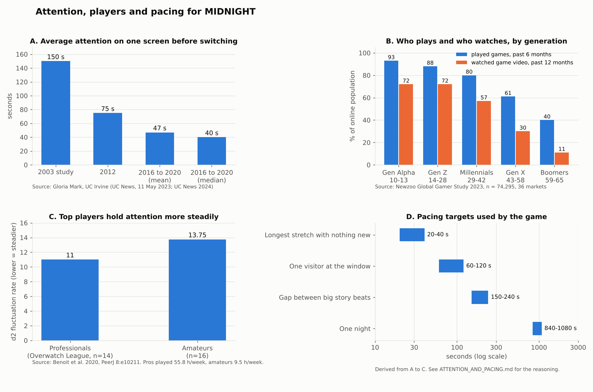

# Attention spans and how MIDNIGHT is paced

The chart is built by `tools/attention-chart.py`. Every number in panels A to C comes from the sources listed at the bottom. Panel D is what the game does with those numbers.

## What the sources say

**A. Attention on a screen (Gloria Mark, UC Irvine).** Mark has measured how long people stay on one screen before switching since 2003. Her studies found about 2.5 minutes in 2003, 75 seconds in 2012, and 47 seconds on average across studies from 2016 to 2020, with a median of 40 seconds. She says the figure has held steady at about 47 seconds for roughly five years. These are office and everyday computer users, not gamers, so they set a floor: if nothing changes on screen for about 40 seconds, half of people will already have looked away.

**B. Who plays, by generation (Newzoo Global Gamer Study 2023).** A survey of 74,295 people in 36 markets, fieldwork February to May 2023. Share of the online population who played in the past six months: Gen Alpha 93%, Gen Z 88%, Millennials 80%, Gen X 61%, Boomers 40%. Share who watched gaming video in the past year: 72%, 72%, 57%, 30%, 11%. Gen Z and Millennials are the core audience for a horror game like this, and most of them also watch other people play it. That makes the moments a streamer reacts to on camera worth designing for.

**Session length (Newzoo Global Gamer Study 2024).** PC and console players play about 2.1 hours per day on the days they play, on 2.6 to 2.7 days a week. Mobile players play 1.6 hours a day, 3.4 days a week.

**C. Top players (Benoit et al. 2020, PeerJ 8:e10211).** 14 professional Overwatch League players against 16 habitual amateur players. Professionals played 55.8 hours a week, amateurs 9.5. Professionals scored higher on selective attention (d2 total 546 vs 494) and held attention more steadily (d2 fluctuation rate 11 vs 13.75, lower is steadier). Their biggest advantage was visual and spatial short-term memory. The sample is small and the design cannot say whether gaming causes this. What it does say: experienced players can hold focus on subtle detail for longer, so the hardest tells belong in the later nights.

## What was left out, and why

* **The "8 second attention span" and "Gen Z has 8 seconds" figures.** These come from a 2015 marketing report, not a study with a published method, and the brief asked for credible sources only.
* **Attention span in seconds by generation.** I found no peer-reviewed or large-sample measurement that gives Gen Z and Millennials separate attention spans in seconds. The generation data above is about who plays and watches, not how long they focus.
* **Hours per week by generation from small marketing surveys.** Several articles quote these from agency surveys without sample sizes. Newzoo's numbers were used instead.

## The pacing rules the game uses

1. **No more than 20 to 40 seconds without something new.** The median screen attention is 40 seconds. Between visitors the night director fills dead air with a sound, a line, a light, or a visitor arriving. Gaps between visitors are 12 to 30 seconds.
2. **One visitor takes 60 to 120 seconds.** Five questions, a records check and a look at the face fits in that window. Something changes inside each visit (a stare, a tic, a slip, an interruption) so the exchange does not go flat.
3. **A big story beat every 150 to 240 seconds.** A phone call, a staff member in person, a job, a power cut or a set piece.
4. **One night lasts 14 to 18 minutes.** That is short enough to finish in one sitting and short enough that a death, which restarts the night, does not feel like a lost evening. Six nights come to about 1.5 to 2 hours, which fits a typical day's play for a PC or console player (2.1 hours).
5. **Tells get subtler night by night.** Night 1 fakes have obvious tells. By nights 5 and 6 a fake shows one small sign that you only see close up. This follows panel C: the players who stay to the end are the ones who can hold attention on fine detail.
6. **Design for the person watching.** Most of the audience also watches gameplay video. Big readable reactions (the face close-up, the passage behind you, the end-of-demo scare) are placed where a streamer will be looking.

These targets live in code in `src/data/pacing.ts`.

## Sources

* Gloria Mark, interviewed by Cara Capuano, "Can't pay attention? You're not alone", UC Irvine / University of California News, 11 May 2023. https://www.universityofcalifornia.edu/news/cant-pay-attention-youre-not-alone
* Gloria Mark, "How to sharpen your attention and meet your goals in 2024", University of California News. https://www.universityofcalifornia.edu/news/how-sharpen-your-attention-and-meet-your-goals-2024
* Newzoo, "How different generations engage with video games today" (Global Gamer Study 2023). https://investgame.net/wp-content/uploads/2024/03/2023_Newzoo_How_different_generations_engage_with_video_games_today.pdf
* Newzoo Global Gamer Study 2024, summarised by GameDev Reports, 2 July 2024. https://gamedevreports.substack.com/p/newzoo-how-people-engage-with-games
* Benoit et al. (2020). The neuropsychological profile of professional action video game players. PeerJ 8:e10211. https://peerj.com/articles/10211
